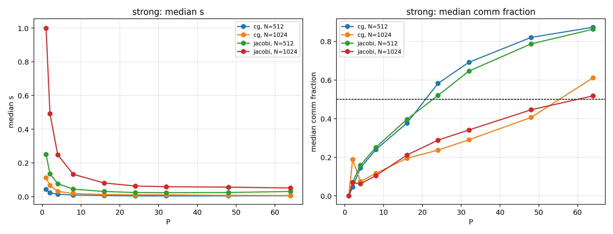
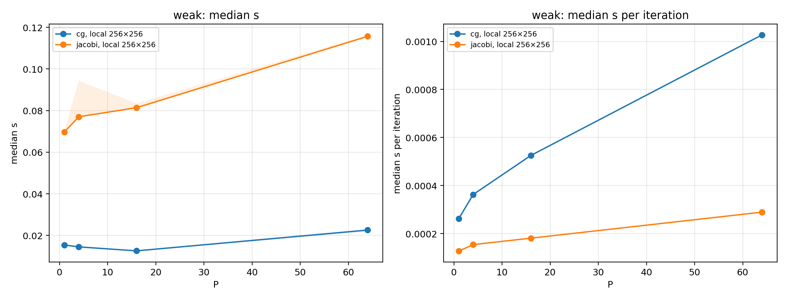
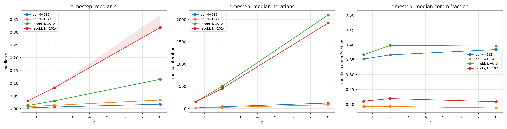

# Parallel implicit heat diffusion: Jacobi versus conjugate gradient

## Objective and model

We compare time to solution and the balance between local computation and MPI communication for distributed Jacobi and unpreconditioned conjugate gradient (CG). Both solve the same backward Euler discretization of the heat equation on the unit square, with zero Dirichlet boundaries, diffusivity α=1, and an N×N interior grid. With h=1/(N+1), each physical step solves (I−αΔt L_h)x=b, using the five-point discrete Laplacian. We specify r=αΔt/h² directly; r=2 for the main study. Both solvers start from x=b and use a relative true-residual tolerance of 10⁻⁸.

The MPI implementation uses nonperiodic Cartesian blocks with packed halo exchanges. Jacobi checks convergence after the first update and every ten updates; CG uses global dot-product reductions each iteration. Both use the same deterministic multi-feature Gaussian initial field. Five measured physical steps follow a discarded warm-up, after which the field is reset. Since r is fixed when N changes, Δt changes too: these are solver-scaling experiments, not equal-physical-time comparisons.

## Correctness and validation

Cluster tests passed independent dense serial-reference comparisons; uneven decompositions on 1–4 ranks; direct stencil, boundary and halo checks in both Cartesian orientations; discrete sine-mode amplification; fixed-final-time refinement; zero and initially converged inputs; single-cell blocks; and nonconvergence and invalid-argument tests. A separate diagnostic build verified critical-rank selection against independently gathered rank timings for both solvers. It also reproduced a CG recursive residual below tolerance with a true residual above tolerance and verified that the solve was rejected. The benchmark executable did not enable diagnostic instrumentation. See `../results/validation-12312723.log`.

## Experimental method

The extended study (Slurm job 12312735) produced 280 valid runs across 56 groups, five trials per group. Strong scaling uses N=512 and 1024 and P=1, 2, 4, 8, 16, 24, 32, 48 and 64 ranks. The allocation used two exclusive AMD EPYC 7713 nodes, ccc0391 and ccc0392, with core binding: P=1 used one node, and P≥2 was evenly distributed over both. All runs completed five steps and passed the true-residual tolerance; the largest recorded residual was 9.985×10⁻⁹. The original three-trial study is retained separately and not pooled with this allocation.

The measured solve time is the sum of each step's maximum rank solve duration, excluding initialization, validation and output. For each step, compute, halo, reduction and other components come from that same slowest rank. Packing is counted as local work. Communication fraction is (halo MPI time + collective MPI time)/(local compute time + those MPI times); other overhead is excluded from this fraction. MPI call time includes waiting and imbalance, not just network transfer. “Compute-dominated” is an operational comparison against MPI time, not a claim about CPU versus memory-bandwidth limits.

## Strong scaling and communication

CG had lower median solve time than Jacobi for all tested strong-scaling configurations. At N=512 and P=32, Jacobi took 0.02319 s versus 0.004525 s for CG (5.13×); at N=1024 and P=64, the corresponding times were 0.05140 s and 0.006689 s (7.68×). These are ratios of medians across separate repetitions, not paired causal estimates.

For N=512, both solvers crossed the 50% communication threshold between P=16 and P=24. Jacobi's median fraction was 39.6% at 16 and 52.0% at 24 (trial range at 24: 50.5–52.9%); CG's was 37.7% and 58.2% (range at 24: 56.3–58.8%). For N=1024, both crossed between P=48 and P=64: Jacobi's medians were 44.6% and 51.8% (range at 64: 51.6–53.6%), and CG's were 40.6% and 61.2% (range at 64: 60.7–62.8%). These brackets are between sampled ranks, not precise threshold estimates.

At N=512, both solvers' median time decreased through P=32 and increased at P=48 and 64. At N=1024, median time continued to decrease through P=64 even though communication exceeded half the measured compute-plus-MPI time. Thus communication dominance need not immediately imply that adding ranks increases total runtime.

## Weak scaling and timestep sensitivity

Weak scaling uses (N,P)=(256,1),(512,4),(1024,16),(2048,64), maintaining 256×256 owned cells per rank. Median five-step time increased from 0.0697 to 0.1157 s for Jacobi and from 0.0154 to 0.0226 s for CG. Iteration counts fell with N, so total time alone conceals per-iteration changes: median time per update rose from 0.127 to 0.289 ms for Jacobi and from 0.262 to 1.027 ms for CG. The reported per-update time divides total solve time—including initialization and convergence checks within each solve—by the total updates; it is not an isolated kernel measurement.

At N=1024 and P=16, increasing r from 0.5 to 8 increased Jacobi's total updates over five steps from 150 to 1920 and CG's from 11 to 85. Their median solve times increased from 0.0307 to 0.3176 s and from 0.00806 to 0.0338 s, respectively. Larger r changes the linear system and physical timestep; numerical stability does not imply equal accuracy, and these are not equal-physical-time comparisons.

## Limitations and reproducibility

The five trials were taken close together in one allocation and do not measure day-to-day variation. P=1 uses one node while P≥2 uses two, confounding the baseline's topology change with process count. Jacobi's P=64 communication fraction at N=1024 is only modestly above 50%. These results are specific to the initial field, tolerance, timestep parameter, solver implementations and allocation; a same-P one-node versus two-node control was not measured. Full rank-by-rank timing distributions were not retained for the benchmark runs. The diagnostic checks validate selection logic but do not reconstruct those missing records.

Raw records, stderr, job log, node details and source/binary hashes are under `../results/data/extended-12312735/` and `../results/data/heat-extended-12312735.log`. Run `python scripts/analyze_extended.py results/data/extended-12312735 --output results/extended-analysis-12312735` and then `python scripts/render_pdf.py` from the project root. The original three-trial results are in `../results/core-12297017/`; they are not silently combined with the extended study.
