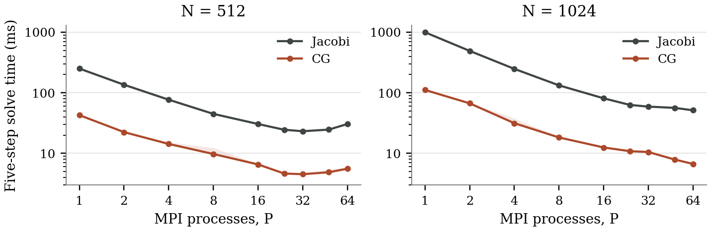

# Parallel implicit heat diffusion: two-page summary

Srikar Palani, Suprathik Vinayakula - CS 598, Fall 2026

## 1 Goal and approach

We compare the time needed by Jacobi and conjugate gradient (CG) to solve the same heat-diffusion problem with MPI. The model is a unit-square plate with warm regions inside and edges held at zero temperature. Backward Euler advances the simulation by solving A x = b: b is the current temperature field, and x is the next field.

MPI processes own rectangular grid blocks and exchange neighboring temperatures through halos. Global reductions combine information across all processes. Jacobi makes simple local corrections but needs many iterations. CG uses more global information per iteration, but usually requires far fewer iterations. We compare **complete time to the same residual tolerance**, not just the cost of one update.

## 2 Experimental design

The extended study contains **280 runs: 56 study-specific groups, five trials each**. It uses two exclusive AMD EPYC 7713 nodes, each with two 64-core sockets. Each rank is bound to a physical core. The one-rank baseline uses one node; larger runs use both. Every run measures five physical steps after a discarded warm-up and field reset. We report median runtime, summing each step's slowest-rank time.

**Strong scaling** fixes N = 512 or 1024 and increases P from 1 to 64. **Weak scaling** grows the total grid while each rank owns 256-by-256 cells. A separate timestep study varies r = 0.5, 2, and 8 at P = 16. Here, N is grid points per side, P is MPI process count, and r sets the timestep relative to grid spacing.

## 3 Main findings

| N | P | Jacobi (ms) | CG (ms) | CG advantage |
| --- | --- | --- | --- | --- |
| 512 | 32 | 23.190 | 4.525 | 5.13 times |
| 1024 | 64 | 51.396 | 6.689 | 7.68 times |

**CG was faster in all 18 strong-scaling comparisons.** For N = 1024 and P = 64, CG requires 24 updates across five steps, versus Jacobi's 450. Its lower update count outweighs the higher cost per update. For N = 512, both solvers are fastest at the sampled P = 32 and slow down at 48 and 64. For N = 1024, both still improve through P = 64; the optimal process count was not established.

**Larger grids postpone communication dominance.** MPI time exceeds half of computation-plus-MPI time between 16 and 24 ranks for N = 512, and between 48 and 64 for N = 1024. MPI time includes waiting and imbalance; other bookkeeping is excluded from this fraction. Crossing 50% does not immediately make added processes harmful, and the data do not establish a universal optimal MPI percentage.

## 4 Weak scaling and timestep effects

With 256-by-256 cells per rank, increasing P from 1 to 64 raises Jacobi runtime from 69.7 to 115.7 ms and CG from 15.4 to 22.6 ms. CG initially gets slightly faster because its update count falls enough to offset its rising cost per update. **Fixed cells per rank do not guarantee fixed iteration counts.** The scaling studies hold r fixed, so finer grids use smaller physical timesteps and can give a better starting guess.

At N = 1024 and P = 16, increasing r from 0.5 to 8 increases Jacobi updates from 150 to 1920 and CG from 11 to 85. Median runtimes rise from 30.7 to 317.6 ms and from 8.06 to 33.8 ms, respectively. Larger steps change the linear system. These five-step runs cover different physical durations, rather than equal final simulation times.

## 5 Correctness, limits, and conclusion

All 280 runs passed an independently recomputed relative-residual tolerance of 10^(-8). Tests also compare small cases with an independent serial solver and a known sine-mode solution, and check halos, boundaries, uneven partitions, and failure handling. Five nearby trials in one allocation do not capture day-to-day variability. The one-node baseline versus two-node runs also mixes topology changes with process count.

**For this workload, CG gives lower time to solution, while useful parallelism depends on grid size and communication cost.** Results are specific to the initial field, tolerance, timestep parameter, implementations, and hardware.

Measurements: results/extended-analysis-12312735/summary.csv. The detailed report and raw records remain in the repository.
