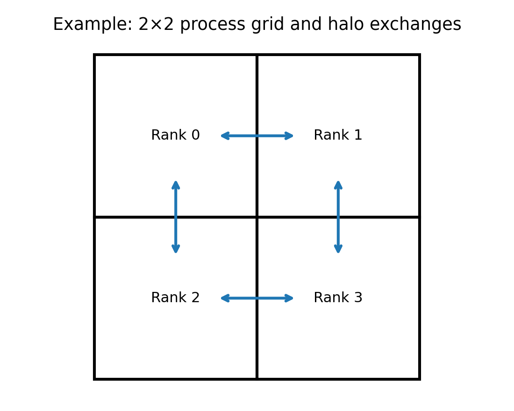
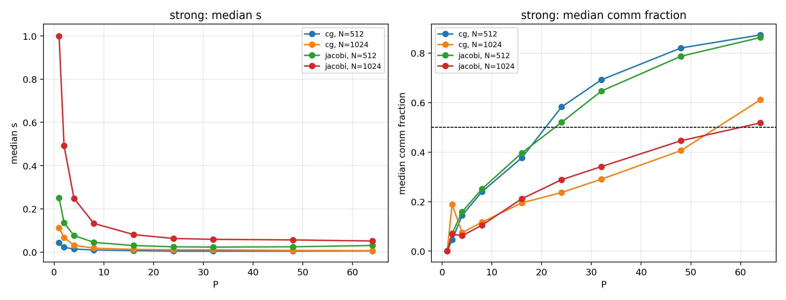
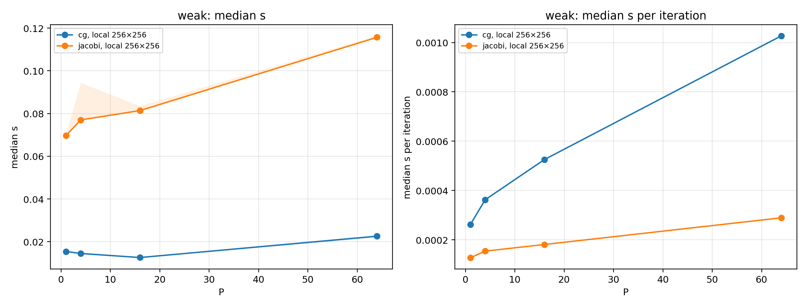
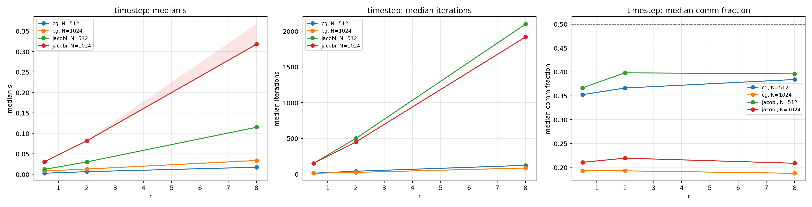
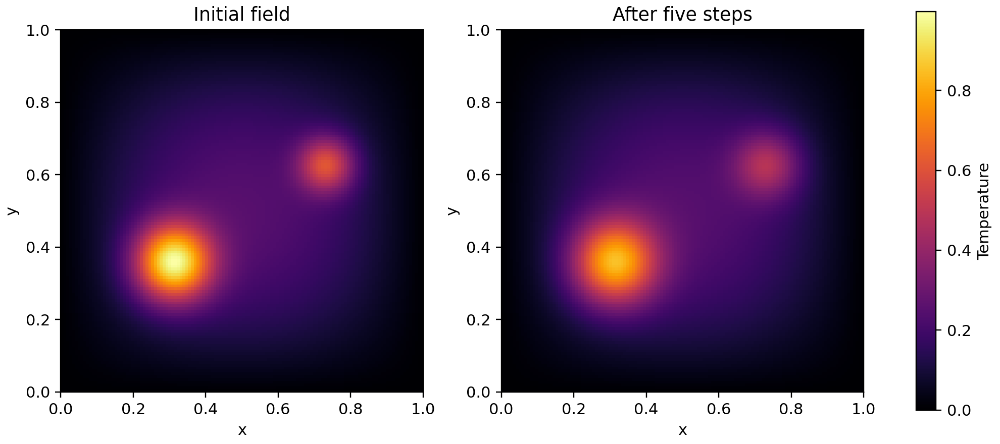

# Implicit heat: Jacobi vs CG

2D backward Euler • MPI scaling study

When does measured MPI time overtake local computation?

---

# Model and methods

Unit square, zero boundaries; five-point backward Euler system.

Both solvers use the same initial field, matrix and true-residual tolerance.

Jacobi checks every 10 updates; CG uses global reductions each iteration.

---

# Parallel decomposition and validation

Serial reference, analytic refinement, halo tests, true residual and critical-rank diagnostics passed.

---

# Experiment

N=512 and 1024; 1–64 ranks; five trials per configuration.

Two exclusive AMD EPYC 7713 nodes; one node at P=1, two at P≥2.

Five measured steps after reset warm-up; fixed r=2 in strong scaling.

---

# Strong scaling and crossover

Communication crossover: N=512 between 16–24 ranks; N=1024 between 48–64 ranks, for both solvers.

---

# Weak scaling

256×256 cells per rank; update counts change with grid size.

---

# Timestep sensitivity

Larger r increases the work to solve each implicit step; this is not an equal-physical-time comparison.

---

# Temperature field

Visualization from a separate small measured run; shared color scale.

---

# Conclusions and limitations

CG was faster in every tested strong-scaling configuration.

For N=1024, both solvers were communication-dominated at 64 ranks, while total time still decreased.

MPI time includes waiting; five nearby trials and the P=1 topology change limit generalization.
